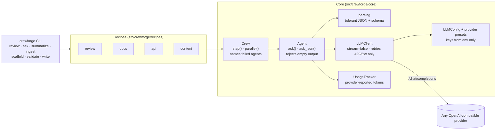

# crewforge

**One crew of LLM agents, four recipes — code review, document Q&A, API scaffolding and content — on any OpenAI-compatible provider, and it fails loudly instead of pretending.**

[](https://github.com/aimanmalib/crewforge/actions/workflows/ci.yml)
[](https://pypi.org/project/crewforge/)


```bash
crewforge review src/                                  # six reviewers + a summary
crewforge ask handbook.pdf -q "How many leave days?" --verify
crewforge scaffold "Todo API: list, create and delete todos" -o todo-api
crewforge write "Why unit tests matter" -f markdown -f html
```

<p align="center">
  
</p>
<p align="center"><sub>A real run of <code>crewforge review</code>: seven agents, ~25 s, provider-reported tokens. Recorded with <a href="https://github.com/charmbracelet/vhs">VHS</a> from <a href="https://github.com/aimanmalib/crewforge/blob/main/docs/demo/review.tape"><code>docs/demo/review.tape</code></a> using Gemini 3.8 Flash through an OpenAI-compatible gateway (the <code>custom</code> provider). The wait for the model is shown in full.</sub></p>

## Why one crew, four recipes

crewforge started as four separate command-line tools —
[codeguard](https://github.com/aimanmalib/codeguard),
[documind](https://github.com/aimanmalib/documind),
[apiforge](https://github.com/aimanmalib/apiforge) and
[contentforge](https://github.com/aimanmalib/contentforge). Each had its own copy
of the same scaffold: provider presets, an HTTP client, an agent base class, an
asyncio pipeline and a token tracker. Running all four against a real model
showed the copies had drifted and that each hid its failures differently:

- codeguard reported success when every review came back empty;
- documind's `ask` command was a stub;
- apiforge scored a spec with **no endpoints** 100/100;
- contentforge wrote the real API key into its YAML file, and sent `${OPENAI_API_KEY}` literally as the key.

crewforge keeps one core — so a fix lands once — and turns each tool into a
*recipe*: a set of agents plus the steps that connect them. The same core rules
apply to every recipe: non-streaming requests, bounded retries, usage numbers
taken only from the provider, keys only from the environment, and no run that
reports success when an agent produced nothing.

## 60-second quickstart

```bash
pip install crewforge
# optional extras: PDF/DOCX ingestion, and the FastAPI app check in `validate`
pip install "crewforge[docs,api]"
# or the latest main: pip install "crewforge @ git+https://github.com/aimanmalib/crewforge.git"

export OPENAI_API_KEY=sk-...          # or any provider below
crewforge providers                   # list presets and the variable each one reads
crewforge review path/to/file.py
```

Any provider works the same way:

```bash
export GROQ_API_KEY=...
crewforge --provider groq review src/

# any other OpenAI-compatible server (vLLM, LM Studio, a gateway, ...)
crewforge --provider custom --base-url http://localhost:8000/v1 --model my-model ask notes.md -q "..."
```

`crewforge init` writes a `crewforge.yaml` you can pass with `--config`; the key
in it is a `${VAR}` reference, never the value.

## Recipes

Each example below was run against a real model (a Gemini Flash model behind an
OpenAI-compatible router) while building crewforge. Output is abbreviated; token
tables are trimmed to their totals.

| Command | Agents | What you get |
|---|---|---|
| `review PATH` | security, style, complexity, logic, testing, documentation (parallel) → summary | Findings by severity, a decision and a score; `-f json` for CI |
| `ingest FILES` | ingester, indexer (no LLM) | How each file was parsed and chunked |
| `ask FILES -q Q [--verify] [--rerank]` | retriever → answerer → fact-checker | An answer with `[Source N]` citations and a claim-by-claim verdict |
| `summarize FILES` | summarizer | Summary and key points per document |
| `scaffold "DESCRIPTION"` | parser → schema → router, model, auth, test_gen, doc_gen (parallel) → validator | A runnable FastAPI project with `openapi.json`, tests and docs |
| `validate PATH` | validator (no LLM) | Spec check; for a project directory, also checks the app serves every spec operation |
| `write "TOPIC"` | research → outline → writer → SEO → editor ⇄ quality → translator → publisher | Article as Markdown/HTML/JSON, social snippets, a usage file |

### `review`

```text
$ crewforge review app.py -f markdown -o review.md      # app.py builds SQL with an f-string
# crewforge review

**Decision:** REQUEST_CHANGES · **Quality score:** 25/100

### Top issues
1. Critical SQL injection vulnerability caused by string interpolation in database query (CWE-89)
2. Missing unit tests covering basic retrieval, missing records, and inputs with quotes
3. Missing docstring and incomplete type annotations for the 'name' parameter and return value

### Critical (3)
- **SQL Injection via string interpolation** (line 4) [CWE-89] — _security_: ...
  - Fix: conn.execute('SELECT * FROM users WHERE name = ?', (name,)).fetchall()
...
total   7 calls   22,366 tokens (provider-reported)
```

### `ask` and `summarize`

```text
$ crewforge ask kestrel.md -q "How many sensors does Project Kestrel use, and who leads it?" --verify --export session.md
✓ ingested kestrel.md (1 chunks)
Q: How many sensors does Project Kestrel use, and who leads it?
Project Kestrel uses 42 water-level sensors deployed along the Sarawak River, and the project is
led by Nadia Rahman [Source 1].
Confidence: high
Verification: verified (2/2 claims verified)
Exported to: session.md
total   2 calls   5,053 tokens (provider-reported)

$ crewforge summarize kestrel.md --length short
Summary: Project Kestrel is a river-monitoring pilot initiative launched in March 2025 by the
Kuching office under the leadership of Nadia Rahman. ...
total   1 call    2,821 tokens (provider-reported)
```

### `scaffold` and `validate`

```text
$ crewforge scaffold "Todo API: list todos, create a todo with a title, mark a todo done, and delete a todo. Bearer auth." -o todo-api
Wrote 11 files
todo-api/
  .env.example  API.md  Dockerfile  auth.py  main.py  models.py  openapi.json
  requirements.txt  routes.py  tests/conftest.py  tests/test_api.py
Validation: valid · 100/100 (4 operation(s) checked, 0 error(s), 0 warning(s))
App check: OK — app serves 5 route(s)
total   5 calls   20,711 tokens (provider-reported)

$ cd todo-api && pytest -q tests
4 passed

$ crewforge validate todo-api            # offline, no key needed
Validation: valid · 100/100 (4 operation(s) checked, 0 error(s), 0 warning(s))
App check: OK — app serves 5 route(s)
```

The first real run of this recipe produced a project whose own smoke test failed
(`DELETE /todos/1` correctly answered 404 and the generated test did not allow
it); that was fixed with a regression test before this output was taken.

### `write`

```text
$ crewforge write "Why unit tests matter" --words 300 --no-seo --max-iter 1 -f markdown -f html -o article
╭──────────── crewforge write — Why unit tests matter ────────────╮
│ Article: 711 words · quality score 88/100                        │
│ Files:                                                           │
│   article/why-unit-tests-matter.md                               │
│   article/why-unit-tests-matter.html                             │
│   article/why-unit-tests-matter.publisher.json                   │
│ Metrics: article/metrics/20261020_095052.json                    │
╰──────────────────────────────────────────────────────────────────╯
total   6 calls   35,351 tokens (provider-reported)
```

Two honest caveats from that run: the model wrote more than twice the requested
length (`--words` is a target given to the agents, not a hard limit), and the
research agent has no web access, so statistics it quotes come from the model's
training data. Review articles before publishing them.

## Providers

The table is checked against the code by `tests/test_readme.py`.

| Name | Provider | Base URL | Default model | Key variable | Auth |
|---|---|---|---|---|---|
| `openai` | OpenAI | `https://api.openai.com/v1` | `gpt-4o-mini` | `OPENAI_API_KEY` | Bearer |
| `openrouter` | OpenRouter | `https://openrouter.ai/api/v1` | `openai/gpt-4o-mini` | `OPENROUTER_API_KEY` | Bearer |
| `groq` | Groq | `https://api.groq.com/openai/v1` | `llama-3.3-70b-versatile` | `GROQ_API_KEY` | Bearer |
| `deepseek` | DeepSeek | `https://api.deepseek.com/v1` | `deepseek-chat` | `DEEPSEEK_API_KEY` | Bearer |
| `together` | Together AI | `https://api.together.xyz/v1` | `meta-llama/Llama-3.3-70B-Instruct-Turbo` | `TOGETHER_API_KEY` | Bearer |
| `mistral` | Mistral | `https://api.mistral.ai/v1` | `mistral-small-latest` | `MISTRAL_API_KEY` | Bearer |
| `ollama` | Ollama (local) | `http://localhost:11434/v1` | `llama3.1` | `OLLAMA_API_KEY` (optional) | Bearer |
| `llamacpp` | llama.cpp server (local) | `http://localhost:8080/v1` | `local` | `LLAMACPP_API_KEY` (optional) | Bearer |
| `mimo` | Xiaomi MiMo | `https://token-plan-sgp.xiaomimimo.com/v1` | `mimo-v2.5-pro` | `MIMO_API_KEY` | `api-key` header |
| `custom` | Any OpenAI-compatible endpoint | set `--base-url` / `CREWFORGE_BASE_URL` | set `--model` / `CREWFORGE_MODEL` | `CREWFORGE_API_KEY` (optional) | Bearer |

Resolution order for the key, base URL and model: command-line flag or
`crewforge.yaml` → `CREWFORGE_API_KEY` / `CREWFORGE_BASE_URL` / `CREWFORGE_MODEL`
→ the provider's own variables (e.g. `OPENAI_BASE_URL`) → the preset default.
Pick the provider with `--provider` or `CREWFORGE_PROVIDER`; the default is `openai`.
An unknown provider name is a configuration error, not a silent fallback.

## Architecture



- **`core/client.py`** — one async client. It always sends `"stream": false`,
  retries only HTTP 429, 5xx and network/timeout errors (with capped exponential
  backoff that honours `Retry-After`), and fails on the first 401/403/4xx with a
  message naming the variable to fix. The key is only ever a request header.
- **`core/agent.py`** — an agent is a role, a system prompt and per-agent
  sampling defaults. `ask()` records usage and raises if the reply is blank;
  `ask_json()` additionally requires parseable JSON (optionally a pydantic schema).
- **`core/crew.py`** — runs agents as sequential steps or parallel stages and
  turns any failure into a `CrewFailedError` that lists every failed agent.
- **`core/usage.py`** — per-agent calls, tokens, retries and latency, taken from
  the provider's `usage` object. Calls without usage are counted as "not reported",
  never estimated.

Use the core directly:

```python
import asyncio
from crewforge.core import Agent, Crew, LLMConfig


class Haiku(Agent):
    name = "poet"
    system_prompt = "You write one haiku. Nothing else."


async def main():
    async with Crew("demo", LLMConfig(provider="groq")) as crew:
        reply = await crew.step("poet", crew.agent(Haiku).ask("autumn in Kuching"))
        print(reply.content, crew.tracker.one_line())


asyncio.run(main())
```

## Honest failure

A run whose agents return empty or unparseable output, or a validator that
checked nothing, **fails with exit code 1 and names the agent**. It never prints
a success message over a hollow result.

```text
$ crewforge ask kestrel.md -q "Who leads Project Kestrel?"        # with a wrong key
error: docs failed
  ✗ agent 'answerer' (http): HTTP 401 from <base-url> (authentication failed — check OPENAI_API_KEY): API key required for remote API access

$ crewforge validate empty-spec.json
Validation: INVALID · 0/100 (0 operation(s) checked, 1 error(s), 0 warning(s))
  ERROR: No endpoints defined (paths is empty)
```

| Situation | Before (the four tools) | crewforge |
|---|---|---|
| Every reviewer returns nothing | "Review Complete!", exit 0 | exit 1, names each reviewer |
| A reviewer answers in prose | treated as a review | exit 1, `agent 'style' (parse)` |
| Parser returns no endpoints | empty spec scored 100/100 | exit 1, names `parser` |
| Spec has paths but no operations | scored | score 0, invalid, exit 1 |
| Quality agent answers in prose | score 0, loop burns every round | exit 1 after one round, names `quality` |
| Quality never reaches the threshold | article published | exit 1 unless `--accept-below-threshold` |
| Question matches no passage | model asked to answer from nothing | exit 1, names `retriever`, no LLM call |
| Generated code does not compile | template silently reused | exit 1, names the agent |

Exit codes: `0` success · `1` run failed (agent, validator or provider) · `2`
usage or configuration error (bad flag, unknown provider, missing key).

The guards are covered by tests that were checked by removing each guard and
watching them fail; see [docs/porting.md](https://github.com/aimanmalib/crewforge/blob/main/docs/porting.md#honest-failure-guards-and-the-sabotage-check).

## How this was built

crewforge was built with AI coding assistance (Claude Code) under the
direction of its author, Muhammad Aiman. It consolidates four earlier tools by
the same author — [codeguard](https://github.com/aimanmalib/codeguard),
[documind](https://github.com/aimanmalib/documind),
[apiforge](https://github.com/aimanmalib/apiforge) and
[contentforge](https://github.com/aimanmalib/contentforge) — whose test suites
were carried over into this repository (see [docs/porting.md](https://github.com/aimanmalib/crewforge/blob/main/docs/porting.md)
for what was ported, re-targeted at the shared core, or dropped and why).

The evidence that it works is meant to be checkable: the test suite (run
`pytest`; it needs no key and no network), CI on Python 3.10–3.13, and the
real-provider runs shown above, two of which found bugs that were fixed with
tests before the output was recorded.

## Contributing

See [CONTRIBUTING.md](https://github.com/aimanmalib/crewforge/blob/main/CONTRIBUTING.md). In short: `pip install -e ".[dev,docs]"`,
`pytest`, `ruff check . && ruff format --check .`, and every new failure path
needs a test that fails if the guard is removed.

## Security

Please report vulnerabilities privately through
[GitHub private vulnerability reporting](https://github.com/aimanmalib/crewforge/security/advisories/new).
See [SECURITY.md](https://github.com/aimanmalib/crewforge/blob/main/SECURITY.md) for scope notes (what is sent to your provider,
and what `validate` executes).

## License

[MIT](https://github.com/aimanmalib/crewforge/blob/main/LICENSE) © Muhammad Aiman

---

Built by [Sasa Teguh](https://sasateguh.com) · Malaysia
